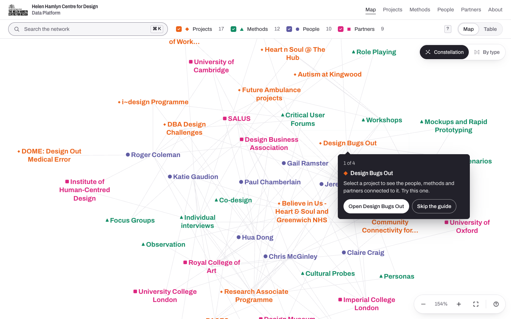
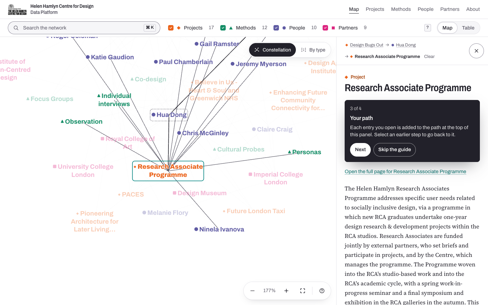
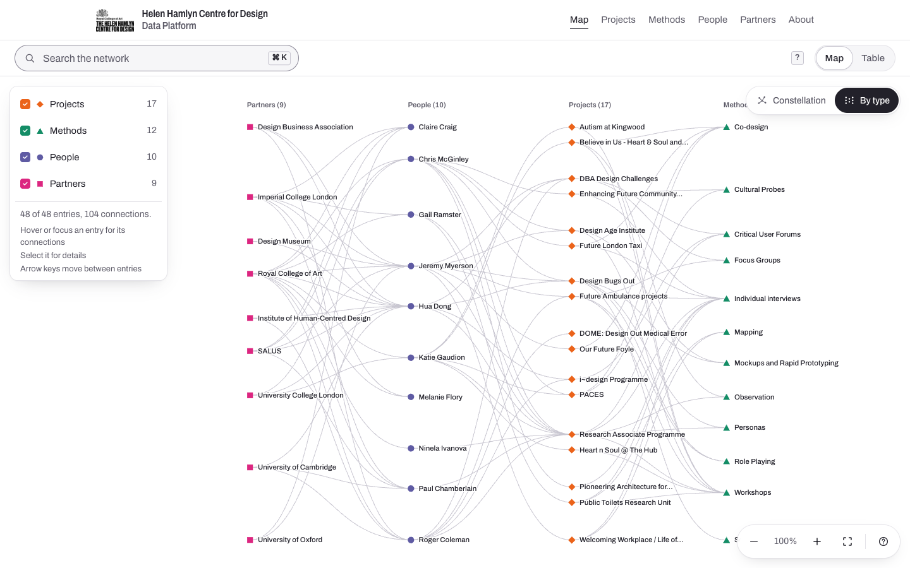

# Helen Hamlyn Centre for Design Data Platform

A public map of research from the Helen Hamlyn Centre for Design at the Royal College of Art: 17 projects, the 12 methods they used, the 10 people who worked on them and 9 partner organisations, and the 104 connections between them. It is for artists, researchers, the public and funders who want to find methods they can adapt to their own work.

Designed and built by Chongbo Ning.

This repository is a rebuild of the [original platform](https://github.com/CBcbbb/Helen-Hamlyn-Centre-Platform) (Create React App, JavaScript, D3). The original is still in use by the Centre and is unchanged. [REPORT.md](REPORT.md) explains what changed and why.

| First visit | Following connections | Arranged by type |
|---|---|---|
|  |  |  |

## What is on the site

- **The map (`/`)** is the home page: every entry and connection as a rhizomatic constellation, with no hierarchy and every entry the same size. As in the original platform, each name is drawn bold in its type's colour, now under a small shape for its type, and connections are soft arcs. One control rearranges the same entries into four columns by type, and back, with an animated move. A legend at the top left doubles as the type filters (behind a Filters button on narrow screens). Search, a details panel, a path of the entries you have opened, and keyboard shortcuts.
- **A first-visit guide** inside the map: one project pulses, and four short cards follow what you do (open it, follow a connection, step back along your path, try the other arrangement). Skippable, remembered in the browser, and restartable from the map's controls or `/?guide`.
- **The table (`/table`)**: every entry in one table (name, type, summary), sortable by type or name, sharing search, filters and details with the map.
- **Entity pages** (`/projects/[slug]`, `/methods/[slug]`, `/people/[slug]`, `/partners/[slug]`): one static page for each of the 48 entries, with its connections listed as links.
- **Index pages** (`/projects`, `/methods`, `/people`, `/partners`) with a short summary of each entry.
- **About (`/about`)**: what the platform is, how to use it, accessibility and translation help.
- **Admin (`/admin`)**: an optional editor for the spreadsheet data, switched off unless configured.

## Run it locally

Needs Node.js 20.9 or later.

```bash
npm install
npm run dev            # http://localhost:3000
```

Production build:

```bash
npm run build
npm start              # http://localhost:3000
```

## Commands

| Command | What it does |
|---|---|
| `npm run dev` | Development server |
| `npm run build` | Production build. Every page is generated at build time. |
| `npm start` | Serve the production build |
| `npm run data:build` | Rebuild `src/data/graphData.json` and `reports/data-report.json` from `data/*.csv` |
| `npm run lint` | ESLint |
| `npm run typecheck` | TypeScript (strict) |
| `npm test` | Unit and component tests (Vitest, Testing Library) |
| `npm run test:e2e` | Playwright and axe tests at 1440px and 390px. Run `npm run build` first. |
| `npm run contrast` | Check WCAG contrast for every colour pairing in `globals.css` |
| `npx tsx scripts/screenshots.ts` | Refresh `docs/screenshots` (needs a running server; set `BASE_URL`) |

For the end-to-end tests, Playwright needs Chromium: `npx playwright install chromium`. If it cannot be downloaded, point `CHROMIUM_PATH` at a local Chrome or Chromium.

## Data

The spreadsheet exports in `data/` are the single source of truth:

```
data/PEOPLE.csv  data/PARTNERS.csv  data/PROJECTS.csv  data/METHODS.csv  data/LINKS.csv
```

`npm run data:build` (`scripts/convert.ts`, logic in `src/lib/convert.ts`) converts them into `src/data/graphData.json`, which the site imports at build time, and writes a data-quality report to `reports/data-report.json`. The report lists skipped rows, duplicate IDs, placeholder cells (such as `/`) treated as empty, links that point to missing IDs, links whose declared type is wrong, duplicate links, unconnected entries and slug collisions. Duplicate IDs stop the build.

Never edit the JSON by hand: edit the CSVs (or use the admin), run `npm run data:build`, and commit both.

The typed data model is in `src/lib/types.ts`. Each entry gets a URL slug from its name; to start the guide from a different project, change `FEATURED_PROJECT_ID` in `src/lib/data.ts`.

## Map layouts

`src/lib/layout.ts` computes both arrangements with d3-force at build time (in `src/app/(network)/layout.tsx`), so the browser never runs the simulation and the map is in the server HTML. d3-force is deterministic, so positions are identical on every build and visit.

- **Constellation**: connected entries attract, all entries repel, and a box-collision pass keeps every mark and label clear of the others. Unit tests check that no two labels overlap and that types are not separated into bands.
- **By type**: each type pulled into its own column, ordered within it to reduce crossings.

Both share one frame, so switching is a pure movement of the same entries: each type sets off slightly after the previous one, and edges blend from straight lines to S-curves. Switching again mid-move turns round smoothly. With reduced motion the switch is instant.

## Colours

All colours are CSS custom properties in `src/app/globals.css`. The HHCD brand colours are unchanged from the original: people `#5F5BA3`, partners `#DC2680`, projects `#EB631A`, methods `#148D66`, accent `#00837F`, with their tint, hover and ring variants. The rebuild adds neutrals and a control-border colour. On the map, names are set in the original brand colours, bold and at least 18.67px on screen (WCAG large text, 3:1); if you zoom out below that, they switch to darker `*-text` variants. Small coloured text elsewhere uses those variants for Projects and Methods; People and Partners pass 4.5:1 in their original colours. Run `npm run contrast` after changing any value.

Each entity type also has a shape (people circles, partners squares, projects diamonds, methods triangles), so type is never shown by colour alone.

## Admin

The admin edits the CSVs in `data/` and rebuilds the JSON and report. It is off unless both environment variables are set (see `.env.example`):

```bash
ADMIN_PASSWORD=choose-a-password
ADMIN_SESSION_SECRET=at-least-32-random-characters
```

Sign in at `/admin`. Sessions are a signed, httpOnly cookie that lasts eight hours. Connections are still edited in `data/LINKS.csv` directly.

Saving needs a writable file system, so it works locally or on a self-hosted server. On Vercel the deployment is read-only, so the admin shows the data but says it cannot save. The original app had the same limit. After saving, rebuild or redeploy to publish, and commit the changed CSVs.

## Environment variables

| Variable | Purpose |
|---|---|
| `NEXT_PUBLIC_SITE_URL` | Absolute URL for canonical links, Open Graph and the sitemap. Falls back to the Vercel production domain, then `http://localhost:3000`. |
| `ADMIN_PASSWORD` | Admin password. Admin is off when unset. |
| `ADMIN_SESSION_SECRET` | Secret for signing admin sessions, 32 characters or more. |

## Stack

Next.js 16 (App Router, static generation), React 19, TypeScript (strict), Tailwind CSS 4, d3-force and d3-zoom, Vitest and Testing Library, Playwright with axe-core. Fonts (Archivo and Source Serif 4) are installed from npm, and the site makes no runtime calls to other services.

## Project structure

```
src/app/(network)/        the map (/) and table (/table), sharing one explorer
src/app/                  entity pages, indexes, about, admin, sitemap, robots, OG images
src/components/           shared UI: entity page and fields, type marks, header, footer
src/components/explore/   map, table, details panel and path, guide cards, dialogs
src/lib/                  data model, conversion, graph helpers, layout, text helpers, admin
scripts/                  convert.ts, contrast.ts, screenshots.ts
data/                     source CSVs
reports/                  data-quality report
e2e/                      Playwright and axe tests
```
