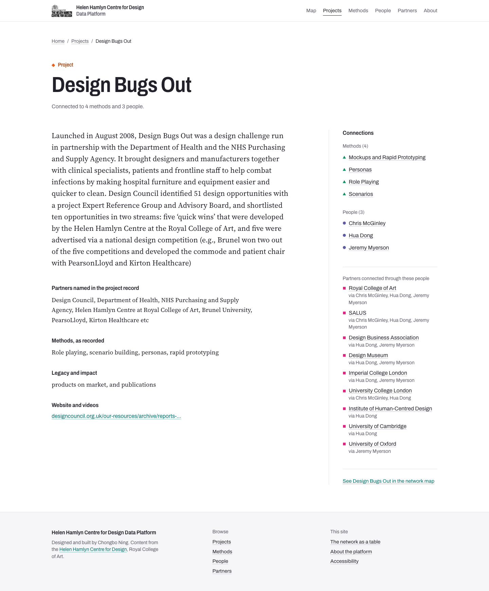
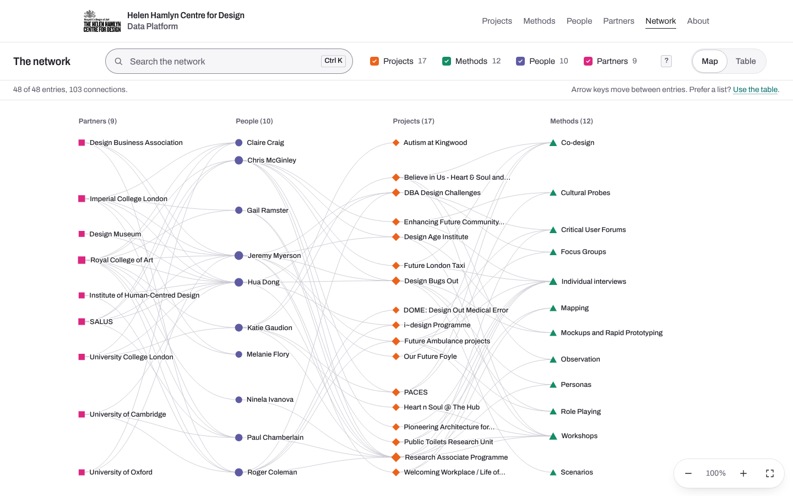

# Helen Hamlyn Centre for Design Data Platform

A public map of research from the Helen Hamlyn Centre for Design at the Royal College of Art: 17 projects, the 12 methods they used, the 10 people who worked on them and 9 partner organisations, and the 103 connections between them. It is for artists, researchers, the public and funders who want to find methods they can adapt to their own work.

Designed and built by Chongbo Ning.

This repository is a rebuild of the [original platform](https://github.com/CBcbbb/Helen-Hamlyn-Centre-Platform) (Create React App, JavaScript, D3). The original is still in use by the Centre and is unchanged. [REPORT.md](REPORT.md) explains what changed and why.

| Home | Project page | Network |
|---|---|---|
|  |  |  |

## What is on the site

- **Home (`/`)** starts from one featured project, then steps outwards: the people and methods behind it, the other projects and partners they lead to, then everything.
- **Entity pages** (`/projects/[slug]`, `/methods/[slug]`, `/people/[slug]`, `/partners/[slug]`): one static page for each of the 48 entries, with its connections listed as links.
- **Index pages** (`/projects`, `/methods`, `/people`, `/partners`) with a short summary of each entry.
- **Network (`/explore` and `/explore/table`)**: the whole network as a map or as tables, with search, type filters, a details panel and keyboard shortcuts.
- **About (`/about`)**: what the platform is, how to use it, accessibility and translation help.
- **Admin (`/admin`)**: an optional editor for the spreadsheet data, switched off unless configured.

## Run it locally

Needs Node.js 20.9 or later.

```bash
npm install
npm run dev            # http://localhost:3000
```

Production build:

```bash
npm run build
npm start              # http://localhost:3000
```

## Commands

| Command | What it does |
|---|---|
| `npm run dev` | Development server |
| `npm run build` | Production build. Every page is generated at build time. |
| `npm start` | Serve the production build |
| `npm run data:build` | Rebuild `src/data/graphData.json` and `reports/data-report.json` from `data/*.csv` |
| `npm run lint` | ESLint |
| `npm run typecheck` | TypeScript (strict) |
| `npm test` | Unit and component tests (Vitest, Testing Library) |
| `npm run test:e2e` | Playwright and axe tests at 1440px and 390px. Run `npm run build` first. |
| `npm run contrast` | Check WCAG contrast for every colour pairing in `globals.css` |
| `npx tsx scripts/screenshots.ts` | Refresh `docs/screenshots` (needs a running server; set `BASE_URL`) |

For the end-to-end tests, Playwright needs Chromium: `npx playwright install chromium`. If it cannot be downloaded, point `CHROMIUM_PATH` at a local Chrome or Chromium.

## Data

The spreadsheet exports in `data/` are the single source of truth:

```
data/PEOPLE.csv  data/PARTNERS.csv  data/PROJECTS.csv  data/METHODS.csv  data/LINKS.csv
```

`npm run data:build` (`scripts/convert.ts`, logic in `src/lib/convert.ts`) converts them into `src/data/graphData.json`, which the site imports at build time, and writes a data-quality report to `reports/data-report.json`. The report lists skipped rows, duplicate IDs, placeholder cells (such as `/`) treated as empty, links that point to missing IDs, links whose declared type is wrong, duplicate links, unconnected entries and slug collisions. Duplicate IDs stop the build.

Never edit the JSON by hand: edit the CSVs (or use the admin), run `npm run data:build`, and commit both.

The typed data model is in `src/lib/types.ts`. Each entry gets a URL slug from its name; to feature a different project on the homepage, change `FEATURED_PROJECT_ID` in `src/lib/data.ts`.

## Colours

All colours are CSS custom properties in `src/app/globals.css`. The HHCD brand colours are unchanged from the original: people `#5F5BA3`, partners `#DC2680`, projects `#EB631A`, methods `#148D66`, accent `#00837F`, with their tint, hover and ring variants. The rebuild adds neutrals, a control-border colour and darker `*-text` variants for type set in colour. Run `npm run contrast` after changing any value.

Each entity type also has a shape (people circles, partners squares, projects diamonds, methods triangles), so type is never shown by colour alone.

## Admin

The admin edits the CSVs in `data/` and rebuilds the JSON and report. It is off unless both environment variables are set (see `.env.example`):

```bash
ADMIN_PASSWORD=choose-a-password
ADMIN_SESSION_SECRET=at-least-32-random-characters
```

Sign in at `/admin`. Sessions are a signed, httpOnly cookie that lasts eight hours. Connections are still edited in `data/LINKS.csv` directly.

Saving needs a writable file system, so it works locally or on a self-hosted server. On Vercel the deployment is read-only, so the admin shows the data but says it cannot save. The original app had the same limit. After saving, rebuild or redeploy to publish, and commit the changed CSVs.

## Environment variables

| Variable | Purpose |
|---|---|
| `NEXT_PUBLIC_SITE_URL` | Absolute URL for canonical links, Open Graph and the sitemap. Falls back to the Vercel production domain, then `http://localhost:3000`. |
| `ADMIN_PASSWORD` | Admin password. Admin is off when unset. |
| `ADMIN_SESSION_SECRET` | Secret for signing admin sessions, 32 characters or more. |

## Stack

Next.js 16 (App Router, static generation), React 19, TypeScript (strict), Tailwind CSS 4, d3-force and d3-zoom, Vitest and Testing Library, Playwright with axe-core. Fonts (Archivo and Source Serif 4) are installed from npm, and the site makes no runtime calls to other services.

## Project structure

```
src/app/                  routes: home, entity pages, indexes, explore, about, admin, sitemap, robots, OG images
src/components/           shared UI: entity page and fields, type marks, header, footer
src/components/explore/   network map, table, details panel, dialogs
src/lib/                  data model, conversion, graph helpers, layout, text helpers, admin
scripts/                  convert.ts, contrast.ts, screenshots.ts
data/                     source CSVs
reports/                  data-quality report
e2e/                      Playwright and axe tests
```
